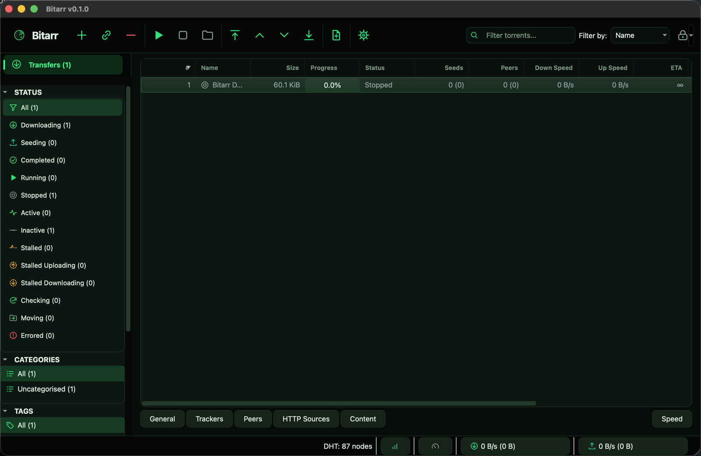
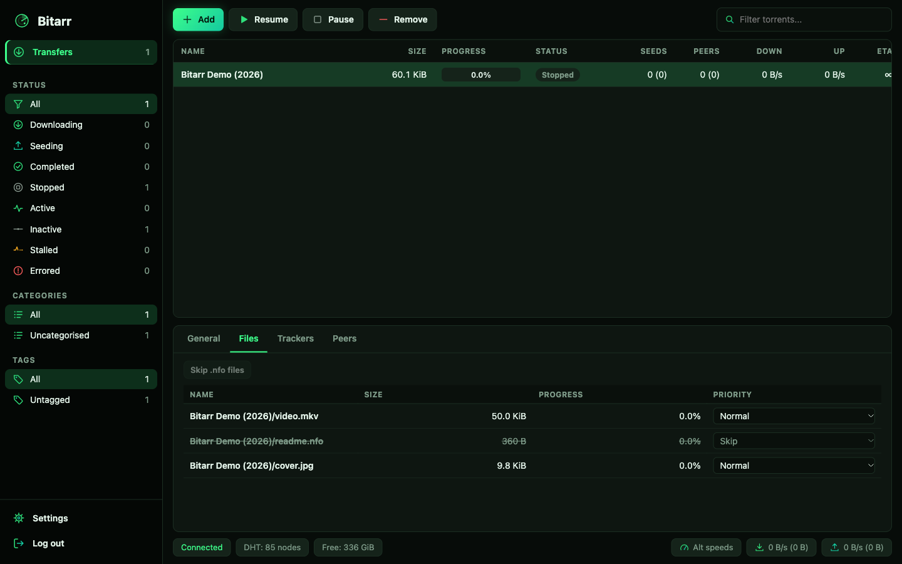

<p align="center">
  
</p>

<h1 align="center">Bitarr</h1>

<p align="center">
  A modern BitTorrent client with a phosphor-green look, a built-in web interface and a few extra download options.<br>
  Based on <a href="https://github.com/qbittorrent/qBittorrent">qBittorrent</a>.
</p>

<p align="center">
  <a href="https://github.com/BoKu/Bitarr/releases/latest"><b>Download the latest release</b></a>
  (currently <b>v0.1.0</b>)
</p>

<p align="center">
  
  
</p>

## Features

- **Modern desktop app (C++/Qt)** with a dark green theme, a single Sonarr/Radarr-style sidebar (pages plus Status, Categories and Tags filters), a redrawn icon set and readable progress labels.
- **New built-in WebUI** in plain HTML, CSS and JavaScript (no build step, no libraries). Live transfers, filters, add/resume/pause/remove, a details panel (General, Files, Trackers, Peers), settings, and a phone-friendly layout. It uses the standard `/api/v2` WebAPI.
- **Extra download options**, in Preferences and in the WebUI settings:
  - Always download in sequential order
  - Always download first and last pieces first
  - Always never download `.nfo` files
- **"Don't download .nfo files"** option in the add torrent/magnet dialog (desktop and WebUI). `.nfo` files are shown as skipped in the file list, case-insensitively.
- **Standalone**: its own name, settings and profile, so it can run next to an installed qBittorrent.
- Everything you expect from qBittorrent underneath: libtorrent-rasterbar, DHT/PeX/LSD, magnet links, RSS, search plugins, queueing, speed limits and categories/tags.

## Install

Download the zip for your platform from the [Releases page](https://github.com/BoKu/Bitarr/releases).

| Platform | Status |
| --- | --- |
| macOS (Intel) | `Bitarr-<version>-macOS-x86_64.zip` |
| macOS (Apple Silicon) | not available yet (build from source) |
| Windows, Linux | not available yet (build from source) |

The macOS app is **not signed or notarised**. The first time, right-click `Bitarr.app` and choose **Open**, or run:

```sh
xattr -dr com.apple.quarantine /path/to/Bitarr.app
```

Bitarr checks this repository for newer releases from **Help > Check for updates**.

## Using the WebUI

Open **Preferences > WebUI**, enable it, set a username and password, then browse to `http://localhost:8080/` (or the port you chose). Without a username and password the WebUI will not start.

## Building

Requirements: a C++20 compiler, CMake 3.16 or newer, Ninja (recommended), Qt 6.6 or newer (Qt 6.10 or newer is recommended on macOS 26), libtorrent-rasterbar 2.0.10 or newer, Boost 1.76 or newer, OpenSSL 3.0.2 or newer and zlib.

```sh
cmake -S . -B build -G Ninja -DCMAKE_BUILD_TYPE=Release \
      -DGUI=ON -DWEBUI=ON -DCMAKE_PREFIX_PATH=/path/to/qt
cmake --build build
```

On macOS the binary is `build/qbittorrent.app` (the bundle name is kept for compatibility). To produce a self-contained app, run Qt's `macdeployqt` on a copy of it. More options are described in [INSTALL](INSTALL).

## Project status

Bitarr is at an early stage (0.1.x). The WebUI does not have Search, RSS, Log or Statistics pages yet and is English only. Feedback and bug reports are welcome in [Issues](https://github.com/BoKu/Bitarr/issues); questions go in [Discussions](https://github.com/BoKu/Bitarr/discussions). See [CONTRIBUTING.md](CONTRIBUTING.md) to help.

## Credits and licence

Bitarr is a custom application based on [qBittorrent](https://github.com/qbittorrent/qBittorrent), created by Christophe Dumez and maintained by the qBittorrent project and its contributors. Their work is the foundation of this program; see [AUTHORS](AUTHORS).

Bitarr is distributed under the GNU General Public License, version 2 or (at your option) any later version, with the OpenSSL exception described in [COPYING](COPYING). It bundles Qt (LGPL v3), libtorrent-rasterbar (BSD), Boost and OpenSSL in its binary releases.
